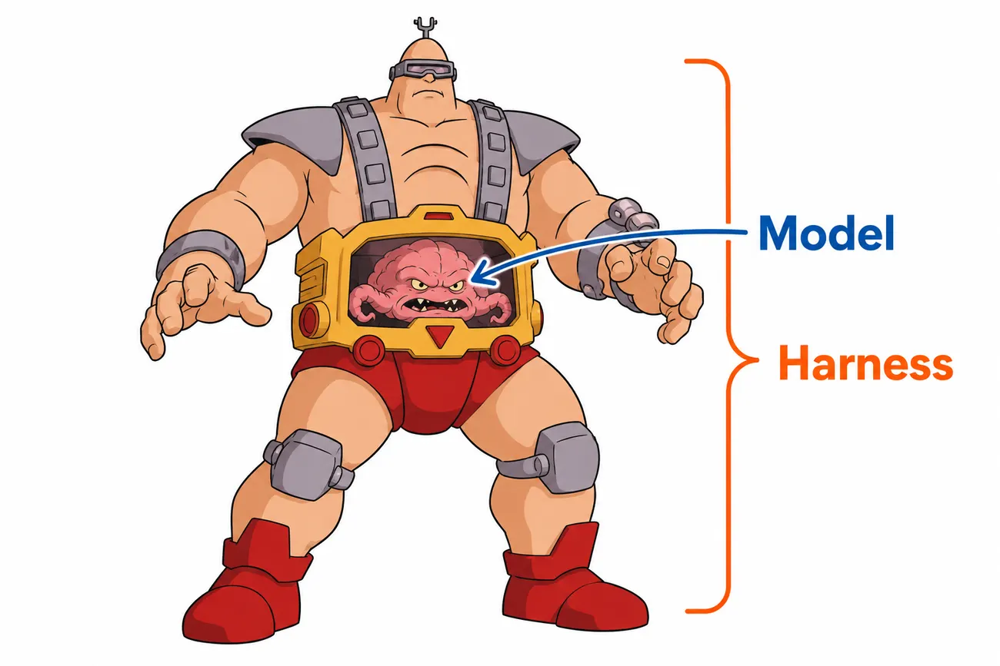
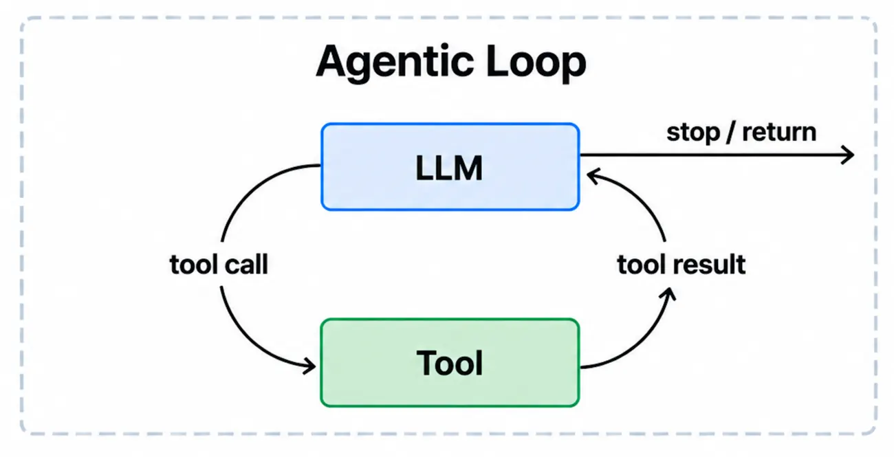
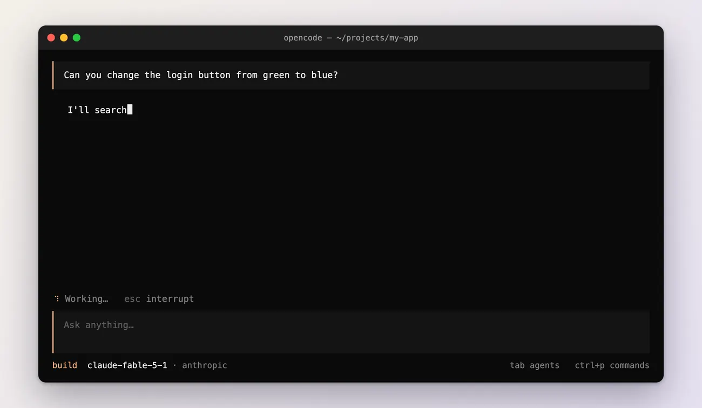
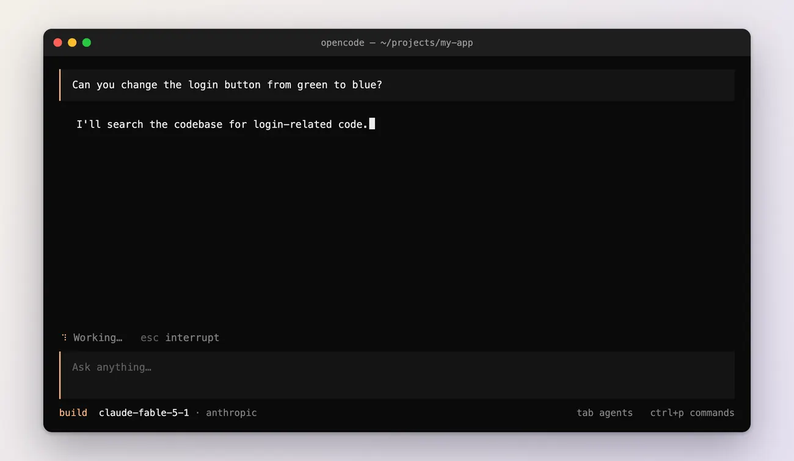
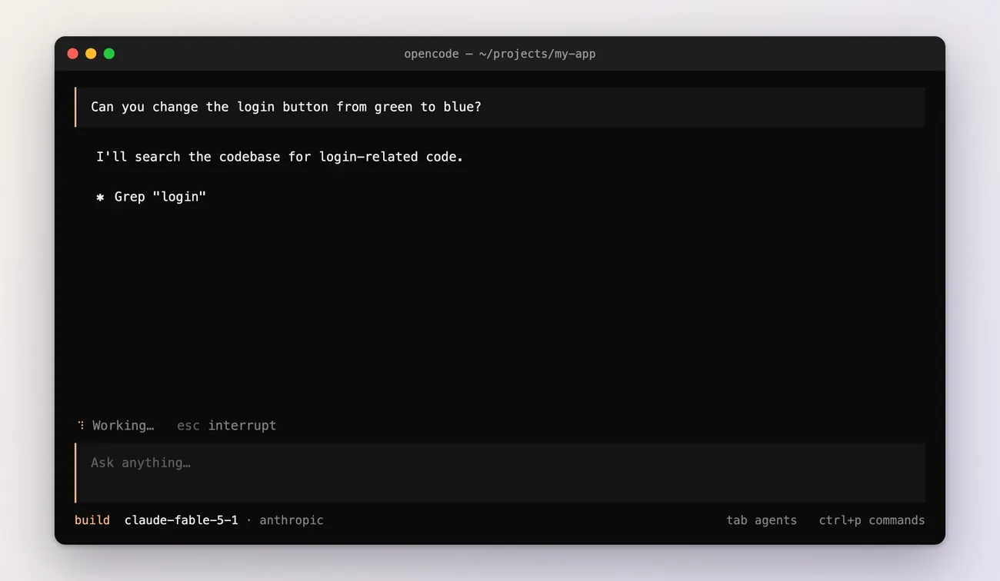
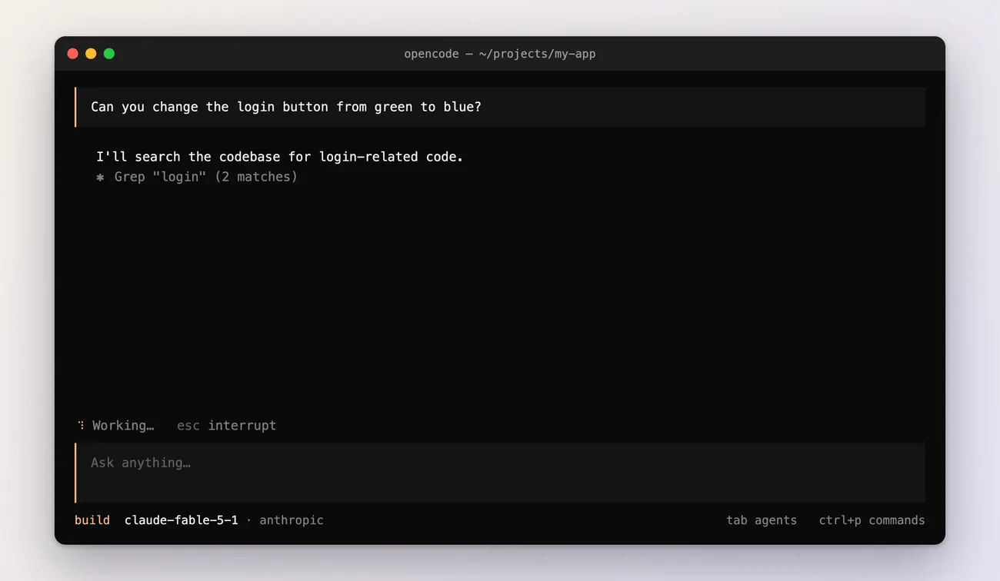
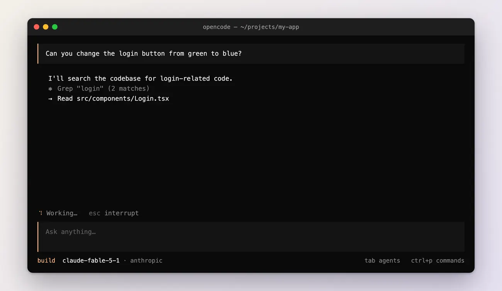
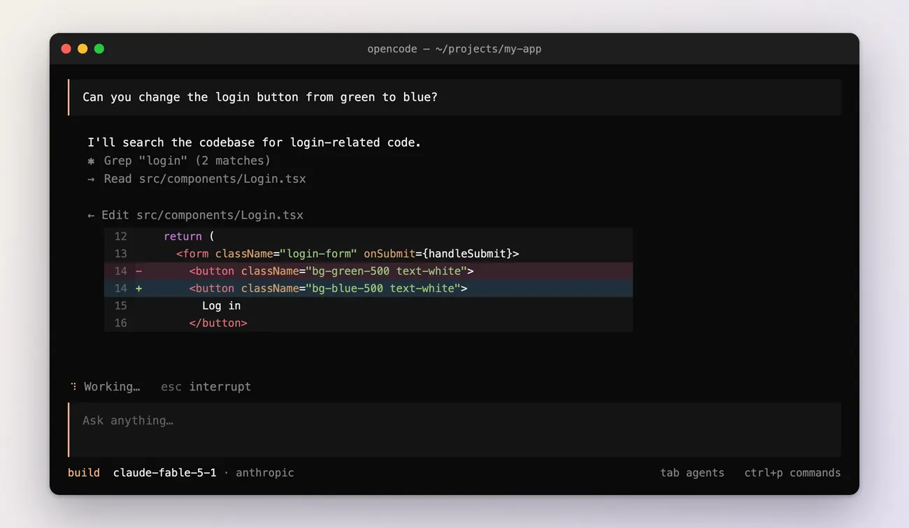
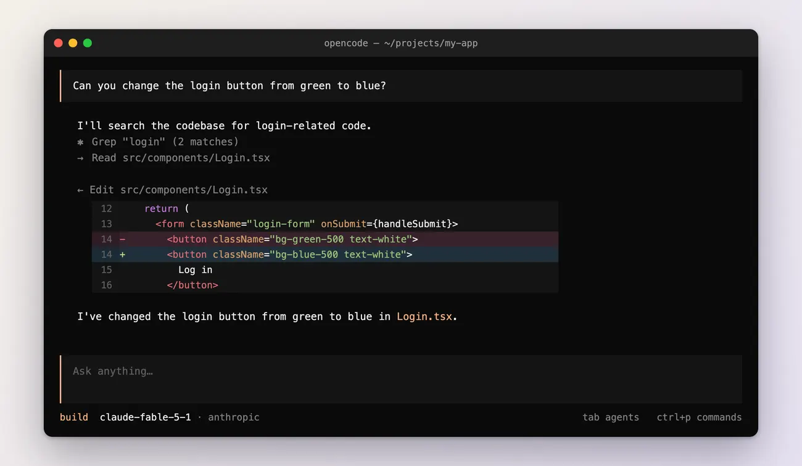

The Merriam-Webster dictionary defines an agent as “one that acts or exerts power.” The concept dates back to the philosophy of Aristotle, whose writings distinguished between things that bring about change and things that are acted upon. It is also a core concept in Western legal traditions, where an “agent” is someone authorized to act on behalf of someone else. Think real estate agent, sports agent, insurance agent.

The term has gained a new meaning in recent years. Although there is still much debate about what exactly qualifies as an “agent” in this new sense of the word, most definitions converge on something like the following: **an agent is an autonomous computer program that can execute tasks independently in pursuit of a goal**.

Like the agents that came before them, these agents are defined by their capacity to act. The difference is that their “intelligence” is artificial — it comes from machine learning models rather than the human brain. Since they are powered by artificial intelligence, we sometimes call them “AI agents.”

AI agents are still very much an emerging technology, and their adoption to this point has been uneven, concentrated in narrow pockets of society. They have achieved their widest adoption so far in the software industry.

If you’re involved in building software, there’s a good chance you’re using a coding agent like Claude Code or Codex as a core part of your workflows, whether for relatively straightforward tasks like code generation or as part of more advanced autonomous setups.

But do you really understand how your coding agent works?

This article is intended for software engineers who use coding agents every day, and want to know what’s happening under the hood. As a bonus, you will be able to take what you learn here and start building agents of your own.

Over the past year, I’ve spent a lot of time figuring out how AI agents actually work: studying source code, following the engineering work of companies like Anthropic, LangChain, and HumanLayer, and building agents myself. In this article, I’ll share what I’ve learned about how these systems are built.

To do this, we’ll start with a conceptual overview of what an agent is, what components it is made of, and how these components work together. Then, we’ll peer under the hood of a popular open-source coding agent, following a single request from start to finish through the source code to see how a real-life agent performs autonomous work on behalf of a user.

### The Large Language Model

It all starts with the large language model (LLM), often referred to simply as “the model.”

An LLM is a machine learning model that accepts a sequence of tokens and predicts what token should come next. A “token” is just a word, a subpart of a word, or a symbol like { or $. This input is called a **prompt**, and the output is called a **response**. For example, given the input “The capital city of Colorado is ”, the model would almost certainly return “Denver.”

By repeatedly predicting the next token, appending it to the sequence, and repeating the process, a model can generate all types of textual responses, including working code.

Modern LLMs have been **trained** on enormous amounts of data, which allows this simple next-token-prediction mechanism to produce quite sophisticated output. During training, the model repeatedly attempts to predict the next token in a sequence, and then compares its prediction to the actual next token in the training data.

By repeating this process billions (or trillions!) of times, it learns patterns in the input data, storing this learning in its **weights**, which are numeric values that are continuously adjusted during training.

Once trained, a model can use its pattern recognition abilities to predict the next token in input it has never seen before, allowing it to reason through problems, write code, summarize information, and perform a wide range of other tasks — all of this through the same basic process of predicting what token should come next.

LLMs are generally **nondeterministic**. Most models won’t always select the same next token each time they are called with the same input. This is because most LLMs use **sampling**, where the next token is selected via a probability distribution over a range of candidates. So, one token may be more _likely_ to be selected than another, but it’s never _guaranteed_ to be. This is in contrast to traditional software, where you can expect the same input to produce the same output (unless randomness has been intentionally written into the program). This unpredictability is fundamental to how agents work.

LLMs are also **stateless**. Each time the model processes input, it starts from scratch. It does not remember the input it was given in the last run, nor does it remember the response it gave. This means that whatever invokes the model must provide it with enough input to perform its job competently, such as the history of previous prompts and responses.

Finally, LLMs have a **context window** — the maximum number of tokens the model can process in a single call, including both input and generated output.

This constraint is largely due to the nature of the **attention mechanism**, which is the algorithm that sits at the heart of large language models. In standard self-attention, processing a sequence involves comparing each token with every other token, resulting in quadratic (O(n²)) computational complexity. This becomes increasingly expensive as the sequence grows, placing practical limits on context length. (Models do have sophisticated caching in place to help mitigate the cost of the algorithm, which I’m ignoring here for simplicity, but the main point still stands — the attention mechanism is computationally expensive.)

So, model providers set a limit on how many tokens the LLM can process in one call. As the number of tokens grows, models can experience noticeable degradation in performance. This is called **context rot**.

> **_Note:_** _I am very much glossing over the details of how LLMs work, which would complicate this discussion too much. If you are interested in learning more about the underlying architecture of LLMs, you can read my article_ [_A Software Engineer’s Guide to Large Language Models_](https://shanehobson.me/blog/a-software-engineers-guide-to-large-language-models/)_._

### Agent = Model + Harness

Large language models are powerful, but they have a number of important limitations.

The most fundamental of these limitations is that a model cannot _act_. A model simply receives input (usually text, but sometimes images or videos) and returns text output. It does not have the ability to edit files, search the internet, execute code, or otherwise interact with the outside world in any way.

As we saw above, a model also cannot _remember_. Each time it runs, it starts fresh with no memory of prior runs.

To address these and other limitations, we give the model a **harness**, which is deterministic code that surrounds the model and allows it to perform actions, remember information, and exercise other capabilities it doesn’t possess natively.

An agent is just the model plus the harness.

If you grew up in the ’90s like me, you may remember the cartoon villain Krang from the original _Teenage Mutant Ninja Turtles_. Krang is a kind of amorphous brain-like creature. Since he has no real body of his own, he places himself in a giant robotic contraption in order to enact his schemes. Krang is analogous to the model, with the contraption he’s inside of being the harness.


_An agent is a model surrounded by a harness._

### Harness = Tools in a Loop

The role of the harness is to compensate for the limitations of the model. So, the best way to approach our discussion of the harness’s architecture is in terms of these limitations.

As we just saw, the model’s most fundamental limitation is that it cannot act in the world; it can only return text. The harness addresses this limitation by providing the model with **tools**, which are functions that the model can request the harness to execute on its behalf.

A tool consists of two parts: a **tool definition** and an **execution function**. The tool definition contains a **name**, **description**, and **input schema**. This information is passed to the model so it can determine when to use the tool and what arguments to provide. The execution function is the code that the harness runs when the model calls the tool.

Simply calling a tool one time is of little value in the real world. What a model really needs to be able to do is to call a tool, see its result, and call _another_ tool based on the result it received from the first tool call, repeating this process until the overall task is accomplished. In other words, the model needs to iterate, calling many tools in succession.

The harness provides this capability via the **agentic loop**.

At its simplest, the loop works like this:

1.  The harness sends the model the current context, including the user’s request and descriptions of the tools available to it.
2.  The model generates a response. Instead of answering the user, it may request a tool call.
3.  The harness detects the tool call, executes the requested function, and adds the result to the context.
4.  The updated context is sent back to the model.
5.  The process repeats until the model produces a final response instead of requesting another tool.

The agentic loop starts with an initial **trigger**. This might be a prompt from a user, such as a developer submitting a request to a coding agent, or it may originate from an automated event, such as a cron job firing, a file being uploaded to a folder, or a bug report being filed in an issue tracker.

Once the trigger occurs, the agentic loop begins. The model processes the initial input and decides which tool to invoke. The harness executes the tool and returns the result, and the process outlined above repeats until a final response is reached. Each pass through the loop (meaning one call to the model plus any tool calls it requests) is known as a **turn** or a **step**.

The pattern of a loop calling the model and executing tool calls iteratively until a stopping point is reached is the heart of what an agentic harness does. Everything else we discuss rests on this core concept.


_The agentic loop._

### Context

We saw above that another shortcoming of large language models is that they are _stateless_: each time a model is prompted, it starts fresh with no memory of past runs.

Since the model has no memory of its own, the harness must supply the model with all data pertinent to the model’s task on any given turn. This information is the model’s **context**.

Context typically consists of three main components.

First is the **system prompt**. The system prompt informs a model what its “role” is — whether it’s supposed to act as a general-purpose agent, or as something more targeted like “researcher” or “code reviewer.” The system prompt also contains other high-level instructions, such as how the model should format its output or when it should pause to ask for permission to do something.

The system prompt is written into the agent’s code by its developer, but it is also often supplemented with user-specific guidance. For example, users of a coding agent may have company- or project-specific guidance they want to pass along to the model. Files like `AGENTS.md` are examples of how users can provide these additional instructions in the system prompt.

The system prompt can also inform the model exactly what model it is (and which version of that model it is), since the model itself doesn’t always inherently know this information.

The second component of context is the list of **tool definitions** the model has access to. We touched on these above — each tool definition contains a name, a description, and an input schema. This data allows the model to decide which tool is appropriate for a given action, and to know what arguments to include in the tool call and what shape the arguments should take.

Third is the **session history** itself. For the model to make effective decisions, it must be aware of what it was initially asked to do, which tools it has called, and the results of those past tool calls. So, each time the harness prompts the model, it passes the history of the session in the prompt.

We saw earlier that models have a context window — a limit to how many tokens can be passed in as input — and that models experience degradation in performance as the number of tokens passed in increases. So, another important job of the harness is **context management**: ensuring that the input provided to the model is as token-efficient as possible.

The harness can manipulate the context in a number of ways before passing it to the model. Perhaps the most common such technique is **compaction**, where the harness summarizes older entries in the session history instead of providing them to the model verbatim. It’s also common for the harness to truncate or omit the results of tool calls if they exceed a certain length before passing them to the model, often saving the full tool result in a file and passing the file path to the model.


_The agentic loop, with context._

### An Agent in Action

Enough theory. Let’s see an actual agent in action.

Here, we’ll trace one task from start to finish through OpenCode, a popular open-source coding agent. We’ll ground our discussion in excerpts from OpenCode’s source code, so we can see how each of the concepts we discussed above is implemented in a real agentic harness.

> **_Note:_** _The code examples below come from version 1.18.33 of OpenCode. I have simplified some aspects of the implementation slightly to make the discussion easier to follow._

#### OpenCode at a High Level

Before diving into the code, let’s look at how OpenCode is organized. OpenCode consists of two main components: a terminal application that serves as the user interface, and a server that hosts the agent itself, both of them running on the user’s machine. The terminal communicates with the server through OpenCode’s Client SDK.

Most of what we discuss below will concern the harness itself, which lives in the server app. Inside the server app, the harness maintains the session history, assembles the model’s context, and runs the agentic loop.

The harness in turn delegates much of its work to the Vercel AI SDK, a popular library that provides a standard interface for interacting with a variety of model providers. It handles prompting the model, streaming the response back, and, when the model requests a tool, calling the execution function OpenCode has supplied for that tool. (From here on, I’ll call it the AI SDK, to avoid confusing it with OpenCode’s own Client SDK.)

As the agent works, the server saves its progress and sends updates back to the terminal via an event stream, allowing the terminal app to report updates to the user in real time.

![OpenCode architecture. On the left, the OpenCode Terminal, the user interface, exchanges messages via the client SDK with the OpenCode Server, which handles session storage, context, and tool execution and contains the agent running the agentic loop. The server exchanges messages with the Vercel AI SDK, which handles model communication, streaming, and tool execution. The AI SDK sends model requests and responses to a model provider such as OpenAI or Anthropic, and makes tool calls to tools such as the file system, shell commands, and web search.](../images/a-software-engineers-guide-to-agents/4.webp)
_OpenCode’s terminal app, server, and the AI SDK._

#### The Request Arrives

Let’s stick to a familiar scenario: a developer asking the agent to make a change to some source code. We’ll assume the developer has OpenCode running in a terminal on their local machine inside a directory containing a code repository. The user prompts OpenCode with the following: **“Can you change the login button from green to blue?”**

The first thing OpenCode does when it receives the initial request from the user is start a new session.

The session is the record of everything that happens during the agent’s execution. This includes the initial request, all tool calls invoked by the model, all responses returned from tool calls, and the model’s final response that closes the loop.

The following code creates a new session:

```javascript
const res = await sdk.client.session.create({
  directory,
  agent: agent.name,
  model: { providerID: selectedModel.providerID, modelID: selectedModel.modelID },
})
sessionID = res.data.id
```

The `sdk` above is OpenCode’s Client SDK, which forwards the request to the OpenCode server running on the developer’s machine.

When the server receives that request, it creates a new session record in a SQLite database table on the user’s machine. This record will hold the data generated within the session.

After the session is created, OpenCode adds the user’s prompt as the first message in the session:

```javascript
sdk.client.session.prompt({
  sessionID,
  agent: agent.name,
  model: { providerID: selectedModel.providerID, modelID: selectedModel.modelID },
  parts: [
    {
      type: "text",
      text: "Can you change the login button from green to blue?"
    }
  ],
})
```

In OpenCode, each message can have multiple parts. Our user message above has just one part, but if the user did something like attach a document to the prompt, that attachment would be represented as another entry in the `parts` array. Later, we will see an example of a message coming from the model itself, which is called an assistant message.

#### The Loop Begins

When the server receives the prompt, it saves the message and kicks off the loop. We can see that in action here:

```javascript
async function prompt(input) {
  const message = await createUserMessage(input)
  return await runLoop(input.sessionID)
}
```

The loop itself is literally just a while loop. Here’s a skeleton of what the loop looks like:

```javascript
async function runLoop(sessionID) {
  const session = await sessions.get(sessionID)

  while (true) {
    // Step 1: Read the whole conversation back from the database.
    // On the first turn, this is just the user's prompt.
    let msgs = await MessageV2.filterCompacted(sessionID)
    const { user: lastUser, assistant } = MessageV2.latest(msgs)

    // Step 2: Check whether the loop should stop.
    if (
      assistant?.finish &&                 // The model has finished a reply,
      assistant.finish !== "tool-calls"     // and it isn't waiting on a tool.
    ) {
      break
    }

    // Step 3: Look up the model chosen for this request.
    const model = await getModel(lastUser.model.providerID, lastUser.model.modelID, sessionID)

    // Step 4: Build the system prompt and turn the saved messages
    // into the form the model expects.
    const system = [...(await sys.environment(model)), ...(await instruction.system())]
    const modelMsgs = await MessageV2.toModelMessages(msgs, model)

    // Step 5: Gather the tools the model may call.
    const tools = await SessionTools.resolve({ agent, session, model, messages: msgs })

    // Step 6: Call the model.
    const result = await handle.process({ system, messages: modelMsgs, tools, model })
  }
}
```

On each turn, the loop fetches the session history from the database. We see this above in **Step 1**. On this first turn, there will be only one entry in `msgs`: our user’s initial prompt. We will see what the code does with this session history below in Step 4.

Because the session history is persisted outside the loop, we have a nice separation of concerns here. The loop can be stopped at any time, and the session resumed later. This also allows a session to be forked from any point, so a new agentic loop can branch off from an earlier state without modifying the original session.

> **_Note:_** _The function is named_ `filterCompacted` _because OpenCode, like most agents, compacts the session history once it grows past a certain size. When that happens, the model is asked to summarize the conversation so far, and the summary is saved into the session as a special_ `compaction` _message. Every message, tool call, and tool result is still stored in the database, but not all of them make it into the model’s context._ `filterCompacted` _reads the session history in reverse chronological order, collecting entries as it goes, and stops as soon as it reaches a compaction message._

In **Step 2**, OpenCode checks whether the loop should stop. If the “finish reason” emitted from the model was `tool-calls`, then it knows to continue looping. Otherwise, the loop terminates. In our example, this will happen when the model finishes its response with a finish reason of `stop`, indicating that it has finished generating its response without requesting any additional tools. In practice, the loop can also terminate for other reasons, such as errors or execution limits.

In OpenCode, the loop chooses a model on each turn, as we see in **Step 3**. OpenCode records the chosen model on each user message rather than on the session as a whole, so the loop simply uses whatever model the latest prompt asked for. This feature allows users to freely swap models within a session.

In **Step 4**, the loop transforms the messages for the session from the database into the format expected by the AI SDK.

Here the harness also assembles the system prompt: you can see in the code that the system prompt is a combination of (1) information about the model’s environment and (2) instructions for the model. The system prompt also includes (3) information about the model’s role, but this is added further downstream.

In **Step 5**, the harness gathers the tools that will be exposed to the model. OpenCode contains a master list, called the tool registry, of every tool that can potentially be made available to a model. Each agent has access to a subset of those tools, and the harness provides the model with the name, description, and input schema for each tool in that subset. Alongside each definition, OpenCode also hands the AI SDK the tool’s execution function, so the SDK knows what to run when the model calls that tool.

Here’s an example of what the tool definition might look like for a grep tool:

```json
{
  "name": "grep",
  "description": "Fast content search tool that works with any codebase size. Searches file contents using regular expressions. Returns file paths and line numbers with matching lines. Use this tool when you need to find files containing specific patterns.",
  "input_schema": {
    "type": "object",
    "properties": {
      "pattern": {
        "type": "string",
        "description": "The regex pattern to search for in file contents"
      },
      "path": {
        "type": "string",
        "description": "The directory to search in. Defaults to the current working directory."
      },
      "include": {
        "type": "string",
        "description": "File pattern to include in the search (e.g. \"*.js\", \"*.{ts,tsx}\")"
      }
    },
    "required": ["pattern"]
  }
}
```

Tools can be created to do pretty much anything. Below, we’ll see examples of tools for reading and writing code, but coding agents usually have dozens of other tools for doing things like executing code, searching the web, asking the user for clarification, and much, much more.

Finally, in **Step 6**, we call the model via the AI SDK, providing it with the context we gathered above: the system prompt, the session history, and the available tools.

#### The Model Starts Responding

Let’s see what happens when the model starts responding. First, a reminder of Step 6 of the loop:

```javascript
const result = await handle.process({ system, messages: modelMsgs, tools, model })
```

The `handle.process` method asks the AI SDK to call the model. As the model generates its response and the SDK runs OpenCode’s execution functions for any requested tools, the SDK emits a stream of events describing what's happening.

In this walkthrough, we’ll see four kinds of events:

-   `text-delta`: the model generated another piece of text.
-   `tool-call`: the model requested a tool.
-   `tool-result`: a tool finished executing.
-   `step-finish`: the model’s step has finished.

The `handle.process` method consumes the stream and passes each event to a function called `handleEvent`:

```javascript
for await (const event of stream) {
  handleEvent(event)
}
```

`handleEvent` contains a switch statement that performs different actions depending on the type of event it matches on:

```typescript
function handleEvent(value): void {
  switch (value.type) {
    case "text-delta":
      // Save the text and forward it to the terminal
      break
    case "tool-call":
      // Record the tool call and its arguments, and forward to the terminal
      break
    case "tool-result":
      // Save the tool's output and mark the tool call as completed
      break
    case "step-finish":
      // Record why the model stopped, both as a part and on the message itself.
      assistantMessage.finish = value.reason  // "tool-calls" or "stop"
      sessions.updatePart({ type: "step-finish", reason: value.reason, messageID: assistantMessage.id })
      sessions.updateMessage(assistantMessage)
      break
  }
}
```

This pattern — a while loop containing a step that listens to an event stream and delegates to a switch statement to handle each type of event — is common in agentic applications.

Returning to our example, the model may first generate some text describing what it intends to do:

```text
text-delta  "I'll search"
text-delta  " the codebase for login-related code."
```

Each `text-delta` event contains a small piece of the model’s generated text. As these pieces come in, OpenCode saves them to a message on the session, which we will explore in more detail below. It also forwards each piece to the terminal app, so the user sees the text as it streams in:


_The first_ `text-delta` _arrives in the terminal._


_The full sentence after the second_ `text-delta`_._

#### The Model Requests a Tool Call

After processing the user’s initial prompt, the model reasons that it first needs to locate the relevant code, so it requests a call to the `grep` tool:

```text
tool-call  grep { pattern: "Login" }
```

In our example, the model issues a single tool call and finishes its response without generating any more text. Its response includes a “finish reason” of `tool-calls`, indicating that it has requested tool execution. The AI SDK will pass this finish reason along to OpenCode in its event stream once the step is complete, and OpenCode will save it to the session. (We’ll see that happen below.)

Meanwhile, the AI SDK calls the tool’s registered execution function. OpenCode records the tool call as “running” in the database and keeps a reference to it, so it can find it again when the result comes back. It also notifies the terminal app that the tool call is in progress:


_The_ `grep` _tool call shown as running._

The `grep` execution function might look something like the following (ripgrep is an open-source grep tool):

```javascript
execute: async (params) => {
  // Search the project's files for the pattern.
  const matches = await ripgrep.grep({ pattern: params.pattern, limit: 100 })

  // Turn the matches into plain text for the model, grouped by file.
  const output = [`Found ${matches.length} matches`]
  let current = ""
  for (const match of matches) {
    if (match.path !== current) {
      current = match.path
      output.push(`${match.path}:`)
    }
    output.push(`  Line ${match.line}: ${match.text}`)
  }
  return { output: output.join("\n") }
}
```

#### The Tool Call Returns

After some time, the `grep` tool call returns. Its result might look something like this:

```text
Found 2 matches
src/components/Login.tsx:
  Line 8: function Login() {
src/pages/LoginPage.tsx:
  Line 12: import Login from "../components/Login"
```

When the `grep` function finishes, the AI SDK emits a `tool-result` event. As with all other events, the `handleEvent` function we looked at above consumes this event, and this time its switch statement matches on the `tool-result` value.

```typescript
function handleEvent(value): void {
  switch (value.type) {
    // ...Other case handling omitted
    case "tool-result": {
      // Find the tool part we saved when the tool-call event arrived.
      const part = toolCalls[value.toolCallId]

      // Mark it completed and attach the tool's output.
      sessions.updatePart({
        ...part,
        state: {
          status: "completed",
          input: part.state.input,
          output: value.output,
        },
      })
      break
    }
  }
}
```

Inside the switch statement, OpenCode marks the tool call as completed, writes the tool result to the database, and publishes an event for the terminal app. The user sees the tool call has finished:


_The_ `grep` _tool call marked as completed._

Earlier, we noted that the model finished its response with a finish reason of `tool-calls`. Now that the tool call has returned, the AI SDK emits a `step-finish` event including that finish reason.

The entire turn — from the model receiving the initial prompt, generating text, and requesting a tool call, to the harness executing the tool and the AI SDK signaling that the step has finished — is stored as a single assistant message in the database. This message consists of three parts:

```json
{
  "id": "msg_02",
  "role": "assistant",
  "finish": "tool-calls",
  "parts": [
    {
      "type": "text",
      "text": "I'll search the codebase for login-related code."
    },
    {
      "type": "tool",
      "tool": "grep",
      "callID": "call_01",
      "state": {
        "status": "completed",
        "input": { "pattern": "Login" },
        "output": "Found 2 matches\nsrc/components/Login.tsx:\n  Line 8: function Login() {\nsrc/pages/LoginPage.tsx:\n  Line 12: import Login from \"../components/Login\""
      }
    },
    {
      "type": "step-finish",
      "reason": "tool-calls"
    }
  ]
}
```

Note the `"finish": "tool-calls"` on the assistant message. We’ll see what OpenCode does with this in the next section.

Since the model will not emit any more text this turn, the stream ends and control returns to the main while loop.

#### The Loop Continues

On each iteration, the loop checks the finish reason OpenCode recorded for the previous model response. If it’s `tool-calls`, the loop continues iterating. We saw this code earlier in Step 2 of the loop:

```javascript
if (
  assistant?.finish &&                 // The model has finished a reply,
  assistant.finish !== "tool-calls"     // and it isn't waiting on a tool.
) {
  break
}
```

The recorded finish reason here is `tool-calls`, so we continue.

Just as it did before, the loop fetches the session history and packages it into a format that can be given to the AI SDK, which in turn passes it to the model in the model’s desired format. Now, the history includes the `grep` tool call and its result.

The next turn follows the same pattern. With the results of the grep call available, the model reasons that it needs to explore the contents of `Login.tsx`, as that is where the button likely lives. The model requests to invoke a tool called `read`, which will return the contents of the file provided in the `filePath` argument:

```text
tool-call  read { filePath: "src/components/Login.tsx" }
```


_The_ `read` _tool call appears below_ `grep`_._

We then iterate again. After receiving the file contents, the model identifies the button and requests an edit:

```text
tool-call edit {
  filePath: "src/components/Login.tsx",
  oldString: '<button className="bg-green-500 text-white">',
  newString: '<button className="bg-blue-500 text-white">'
}
```

The `edit` tool executes and OpenCode records the result, just as it did with the previous tools. Control then returns to the loop once more.


_The_ `edit` _tool call and its diff._

#### The Final Turn

The loop calls the model one more time, again with the most recent tool call and its result appended to the context. This time, all the tool calls necessary to satisfy the user’s request have been completed, so this will be the final turn.

First, the model generates some text, which the AI SDK emits as a `text-delta` event:

```text
text-delta "I've changed the login button from green to blue in Login.tsx."
```

As before, this text is added to the session and forwarded to the terminal, so the user sees that the button color has been changed.


_The model’s final response._

The model finishes generating its response without requesting any tools. This time, the model’s finish reason is `stop` rather than `tool-calls`.

Since the model requested no tools, the AI SDK has nothing to wait on. So, it emits its `step-finish` event immediately, passing along the finish reason, which OpenCode saves to the assistant message as before. Control is returned to the while loop for a final time.

In previous turns, our finish reason was `tool-calls`, so we did not exit the loop. Now, the finish reason is `stop`, so we finally break out. The agent’s work on this request is done, as is our journey following this task through OpenCode’s system.

### What Else Can You Do With Agents?

This was a simple example intended to illustrate the basic structure of an agent: the loop, context, tool calling, and other building blocks. But there’s a whole world of agentic patterns built on top of these fundamentals, and new use cases are emerging every day in this fast-moving field. Before ending the article, I want to briefly survey some other interesting agentic patterns in use today.

#### Subagents

**Subagents** allow an agent to delegate tasks to other, more narrowly scoped agents. For example, a coding agent may do high-level planning itself but hand off file exploration, research, implementation, and code review to separate subagents.

The main benefit of subagents is context management. When an agent makes a series of tool calls, the results can add a lot of tokens to the model’s context. By delegating this work to a subagent, the original agent keeps its context manageable. The subagent returns a lean summary to the primary agent when its work is done, rather than a large collection of tool calls and their results.

Subagents open the door to **multi-agent systems**, where specialized agents work together as part of a larger system that combines deterministic and nondeterministic software. **Loop engineering** and **graph engineering** are two approaches to orchestrating such systems. Loop engineering involves creating a meta-loop outside of the agentic loop; each time the agentic loop finishes, the outer loop calls it again, until some stopping condition or “goal” is met. Graph engineering takes a more structured approach, organizing agents and other operations into a graph of interconnected steps, with rules governing how control flows between them.

#### Code Mode

As we’ve already seen, dealing with the results of tool calls is one of the biggest challenges in managing context for models. Tool call results can be large and unpredictable, and can quickly overwhelm the model’s context window. Compaction is one method we’ve seen to deal with this; we’ve also touched on approaches involving truncating tool call results.

Another innovative way to solve this problem is to have the model write code that handles tool calling, which is executed by the harness. This is called **code mode**.

To do this, the harness provides an execution environment that can run the model’s code and gives that code access to the model’s tools. The model writes code that returns just the data it needs, not a full tool call result. For example, instead of calling a search tool and receiving hundreds of results in its context, the model could write code that performs the search, filters the results, and returns only the relevant matches.

The result is that fewer tokens get passed back to the model. The downside is that allowing the model to execute arbitrary code can introduce security risks. So, great care must be taken with regard to where that code is executed. The main solution here is **sandboxing**: executing the code in an isolated environment with limited permissions, and restricting its access to files, network connections, and other system resources.

#### Middleware

**Middleware** allows an agent to be extended and customized. Agents that incorporate this pattern expose **hooks** at different points in the agent lifecycle: before the agent is called, before the model is called, before a tool is called, after a tool call returns, etc. At each point in the lifecycle, users can customize behavior by adding their own logic. This pattern allows developers to extend and customize an agent’s behavior without having to modify the underlying agentic loop.

For example, a user may want to add custom logic to truncate tool results in a specific way after a tool call returns. Or, perhaps a user might want to add logic before the model is called that swaps out the model depending on the complexity of the task at hand. There are many other examples where extending an agent’s behavior via middleware can be useful, and new use cases continue to emerge.

#### The Software Factory

Taking these ideas a step further is the emerging concept of the **software factory**: a system that handles much of the software development lifecycle autonomously, with minimal human intervention. Building on the automated triggers we discussed earlier, a software factory consists of many specialized agents that run automatically in response to events.

For example, imagine an error is recorded in an application’s logs. This could automatically trigger an agent, which would create a bug report in the project’s issue tracker. The bug being filed could trigger another agent, which would implement a fix and open a pull request. The opening of the pull request could initiate a code review by yet _another_ agent. Once the fix passes automated tests and the pull request is approved, another agent could merge and deploy the changes.

In this model, the software engineer’s role shifts from writing individual pieces of code toward designing and overseeing the factory itself. How much of this process can reliably be automated remains an open question, and there’s probably more hype than substance surrounding fully autonomous software development right now. But it’s a fascinating direction for the industry, and one I’ll be keeping an eye on going forward.

### The End

We’ve covered a lot of ground, from the basic architecture of AI agents, to the inner workings of a popular open-source coding agent, and finally to some of the more interesting emerging concepts in agentic engineering.

If there’s one thing I hope you take away from this article, it’s that AI agents are built from a relatively simple set of software patterns: loops, tools, context, and event streams. With an understanding of these patterns, you can begin to reason about agents as ordinary software programs, rather than mysterious systems that magically complete coding tasks.

If you’d like to go a level deeper, I recommend reading my article [A Software Engineer’s Guide to Large Language Models](https://shanehobson.me/blog/a-software-engineers-guide-to-large-language-models/). There, I explore the architecture of the model itself, the one component we treated as a black box throughout this article.

For now, I’m having a lot of fun building agents myself, and I’d encourage you to try it too. Pick a problem that agents could help with, build something, and see how far you can take it.
